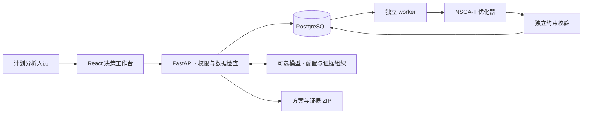

# GateFlow · 登机口分配 AI 决策工作台

**少用一个登机口，会增加多少中转成本？用可视化方案和计算证据作出选择。**

GateFlow 面向机场计划与运行分析场景，把数据检查、多目标优化、方案比较和证据导出连成一个工作流。优化器生成方案，独立检查器复核约束，AI 辅助配置与解释，最终由人选择。

**[打开在线 Demo →](https://hexing-ai.github.io/gateflow-ai/)** · [本地快速开始](#快速开始) · [架构说明](docs/ARCHITECTURE.md) · [竞品分析](docs/COMPETITIVE_ANALYSIS.md)

[](https://github.com/hexing-ai/gateflow-ai/actions/workflows/test.yml)
[](https://github.com/hexing-ai/gateflow-ai/actions/workflows/pages.yml)
[](LICENSE)


## 三分钟体验

无需注册、安装或 API Key，直接打开 **[在线 Demo](https://hexing-ai.github.io/gateflow-ai/)**：

1. **看安排**：点击 T01 等登机口聚焦时间轴，再点航班条查看到离港及缓冲时间。
2. **看取舍**：从「方案 01」切换到「方案 02」。相同的 93.8% 固定口分配率下，使用口数从 11 降至 10，流程成本从 51,815 增至 53,200 人·分钟，模型未满足中转条件人数从 68 增至 87。
3. **看依据**：打开「查看计算依据」检查客流明细，点击「导出样例」下载包含分配结果和计算依据的 ZIP。

这些数字来自 **48 条周转、12 个登机口、39 组客流、1,053 人的合成样例**。候选由 NSGA-II 预计算得到；流程成本包含模型惩罚，模型未满足条件人数不等于实际误机人数。航站楼仅为示意，页面不显示真实机场实时运行数据。

## 为什么做这个项目

- **把多目标取舍看清楚**：同时比较分配覆盖、固定口使用和中转流程成本，避免只看一个最优数字。
- **让结果有据可查**：独立复核占用、兼容和缓冲规则，逐组查看中转成本，并导出数据版本、参数与结果。
- **让 AI 有明确职责**：辅助理解目标和组织证据；指标由程序计算，运行配置由用户确认，模型不能自行修改或发布分配。

## 快速开始

只体验界面，需要 **Node.js 22 和 npm**；不需要 Python、数据库或模型密钥。在 macOS、Linux 或 Windows 终端运行：

```bash
git clone https://github.com/hexing-ai/gateflow-ai.git
cd gateflow-ai
npm ci --prefix web
npm run demo --prefix web
```

打开终端显示的地址，默认 **http://127.0.0.1:5173**。看到「合成样例 · 预计算」、6 套候选和可切换的时间轴，即启动成功。端口被占用时 Vite 会显示新的可用端口；`Ctrl+C` 停止。首次安装时间取决于网络。

`demo` 模式完全在浏览器运行，不请求私人 API。需要上传自己的数据和运行优化任务，请使用下面的完整后端部署。

## 在线演示与完整应用

| 能力 | GitHub Pages / 本地 Demo | 完整后端 |
| --- | --- | --- |
| 航站资源示意、可筛选时间轴、方案对比 | 合成样例，支持交互 | 计算结果驱动 |
| 分配与客流明细、证据 ZIP | 预计算样例 | 按选择生成 |
| CSV 上传、检查与客流匹配 | 不开放 | 支持 |
| NSGA-II 求解、取消与历史 | 不运行 | PostgreSQL + 独立 worker |
| 方案解释 | 确定性差异摘要，不调用外部模型 | 可选模型辅助，数字仍由程序计算 |
| 自然语言配置 | 不调用模型 | 结构化适配；无模型时规则辅助 |
| 身份与持久化 | 公开只读 | 一个预置所有者账号 |

## 完整后端部署

需要 **Docker Compose v2、Python 3.12**。在仓库根目录执行，初始化时设置至少 12 位的所有者密码：

```bash
python3 -m venv .venv
.venv/bin/pip install argon2-cffi
.venv/bin/python scripts/create_env.py
docker compose up --build -d
```

上面的虚拟环境命令适用于 macOS / Linux；Windows 对应使用 `.venv\Scripts\python.exe -m pip install argon2-cffi` 和 `.venv\Scripts\python.exe scripts/create_env.py`。

访问 **http://localhost:8000**，点击左下角「公开演示」登录。健康检查：`curl http://localhost:8000/api/health`。上传 `samples/` 下的三份 CSV，选择运行日 `2026-10-03`，即可检查数据、确认配置、生成并导出方案。

查看日志：`docker compose logs -f api worker`；停止并保留数据库：`docker compose down`。生产环境需配置 HTTPS 和对应来源。容器方案的前提、配置项、数据保留及当前验证范围见 [部署指南](docs/DEPLOYMENT.md)。

## 系统如何工作



公开 Demo 直接加载合成样例，不经过上图后端链路。完整的数据流、模块职责和模型权限见 [架构说明](docs/ARCHITECTURE.md)。

## 文档导航

| 文档 | 内容 |
| --- | --- |
| [产品需求](docs/PRD.md) | 用户任务、功能规则与范围 |
| [竞品分析](docs/COMPETITIVE_ANALYSIS.md) | 8 个竞品及相关系统、视觉观察、产品取舍与来源 |
| [架构说明](docs/ARCHITECTURE.md) | 模块、任务生命周期、AI 与优化器分工 |
| [部署指南](docs/DEPLOYMENT.md) | Pages、Docker Compose、环境配置与故障排查 |
| [开发与数据](docs/DEVELOPMENT.md) | 本地后端、模型接入、数据格式、规则与复现 |
| [验证记录](docs/VALIDATION.md) | 实际执行的测试与适用范围 |
| [视觉设计](docs/DESIGN.md) | 配色、布局、交互与资源来源 |

## 贡献与许可

欢迎通过 [Issues](https://github.com/hexing-ai/gateflow-ai/issues) 提交可复现问题、规则建议或使用反馈，开发流程见 [CONTRIBUTING.md](CONTRIBUTING.md)。如果这个项目对你理解 AI 决策产品或多目标优化有帮助，欢迎 **Star**。

原创代码与文档采用 [MIT](LICENSE)。第三方依赖和视觉资源说明见 [THIRD_PARTY_NOTICES.md](THIRD_PARTY_NOTICES.md)。公开仓库使用合成数据，不包含原始研究数据、论文或竞品图片。
