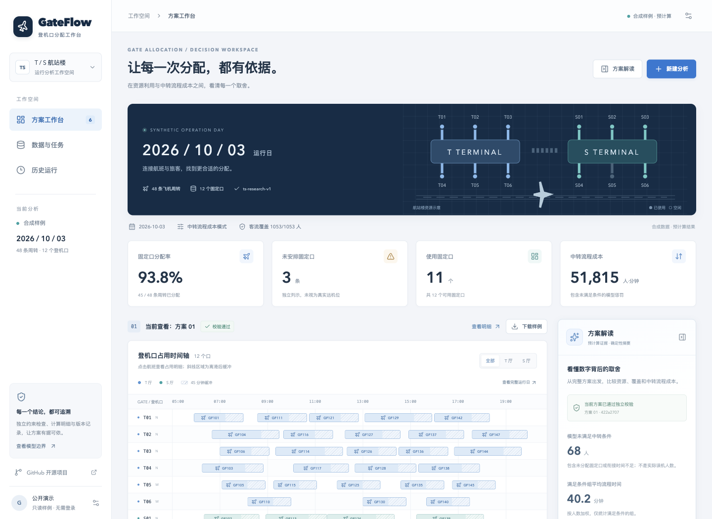

# GateFlow · 登机口分配 AI 决策工作台

用可视化看清登机口分配中的资源与中转成本取舍。优化器生成候选方案，独立检查器复核约束，用户比较并选用方案；AI 接入负责受约束的配置建议与证据组织。

**[访问在线演示](https://hexing-ai.github.io/gateflow-ai/)** · [产品需求](docs/PRD.md) · [部署说明](docs/DEPLOYMENT.md) · [验证记录](docs/VALIDATION.md)



## 在线演示与完整应用

| 能力 | GitHub Pages 演示 | 完整后端部署 |
| --- | --- | --- |
| 航站楼示意、分配甘特图、候选取舍图 | 合成样例 | 上传数据计算结果 |
| 方案切换、2–3 方案比较、周转与客流明细 | 支持 | 支持 |
| 证据包下载 | 预生成样例 ZIP | 服务端按选择生成 ZIP |
| 私人 CSV 上传、检查与客流匹配 | 不开放 | 支持 |
| 后台 NSGA-II 求解、取消、历史与中断恢复 | 不运行 | PostgreSQL + 独立 worker |
| 自然语言配置 | 展示入口，不调用模型 | 结构化模型适配；未配置时规则辅助 |
| 方案解释 | 确定性差异摘要 | 模型选择证据与解读重点，数字由程序渲染 |
| 用户权限 | 公开只读 | 一个预置所有者账号 |

公开演示中的 **48 条周转、12 个口、39 组客流** 均为本项目生成的合成数据，候选由真实 NSGA-II 预计算得到，页面明确标注。未上传原始研究数据、论文或第三方图片。GitHub Pages 不运行 Python 服务，不提供私人数据持久化，也不会冒充实时 AI。

## 完整后端部署

需要 Docker Compose。生产环境置于 HTTPS 反向代理后；API 默认只绑定本机 `127.0.0.1:8000`。

```bash
python3 -m venv .venv
.venv/bin/pip install argon2-cffi
.venv/bin/python scripts/create_env.py
# 在 .env 中设置 PUBLIC_ORIGIN 为实际访问来源。
# 生产 HTTPS 设置 COOKIE_SECURE=true；本机 http://localhost:8000 使用 false。
docker compose up --build -d
```

访问 `http://localhost:8000`。点击“公开演示”头像，输入初始化时设置的所有者密码，进入私人工作空间。上传 CSV 后依次检查数据、确认范围、配置、运行、比较和导出。

PostgreSQL 保存数据版本、原始 CSV、任务、候选、选择和调用记录。worker 使用数据库任务状态与独占锁，计算在可终止的子进程执行。仅支持一个所有者和一个活动求解任务。删除数据集会同步级联删除关联记录；已下载的文件无法收回。

## 本地开发

Python 3.12、Node.js 22。开发辅助脚本通过 `pgserver` 启动真实 PostgreSQL；生产使用 Compose 的数据库服务。

```bash
python3.12 -m venv .venv
.venv/bin/pip install -r backend/requirements-dev.txt
npm ci --prefix web
.venv/bin/python scripts/dev_backend.py
# 另一个终端
npm run dev --prefix web
```

前端：`http://127.0.0.1:5173`；API 文档：`http://127.0.0.1:8000/docs`。本机随机密码保存在 `.local/credentials.json`，该目录已忽略，不要提交或公开。开发页面由 Vite 代理 API。

## 模型接入

服务端支持 OpenAI-compatible Chat Completions。仅在服务端环境设置 `LLM_BASE_URL`（HTTPS，含 `/v1`）、`LLM_API_KEY`、`LLM_MODEL` 与 `LLM_PROVIDER`，重启 API 后由所有者在设置中同意发送范围并启用。不要将密钥写入 `VITE_*` 环境变量。

每个请求最多两次模型调用，账号每日上限 100 次；响应经 Pydantic schema 校验。配置卡必须经用户确认，模型不能修改分配、最终选用、删除数据或下发指令。解释使用限定的解读重点与真实证据 ID，数值及差额来自程序，不接受模型自由生成数字结论。未配置价格时显示费用未知。没有模型时仍可完成表单闭环。

本仓库包含模拟供应商的适配测试；不宣称已完成某家真实模型的端到端验收或 60 条发布评测集。

## 数据与规则

- 三类 CSV 的标准字段见 `samples/*.csv`，支持 UTF-8 / UTF-8-BOM、带引号的多行中文表头。
- 使用运行日占用区间相交规则；原始时间保留，图表可以裁切。固定使用 `Asia/Shanghai`。
- 同一周转在一个固定口，N/W 同类匹配，到达/出发 D/I 分别匹配；离港后缓冲 45 分钟。
- `UNASSIGNED` 是未安排固定口，不是一个无限容量的远机位。
- 资源模式最小化 `(U,G)`；成本模式最小化 `(U,G,C)`。C 是流程时间与惩罚的加权和，单位人·分钟。
- 流程矩阵仅适用于 T/S 研究布局，不包含真实步行、捷运和机场生产规则。
- 未知机型不默认窄体。原 CSV 若只有机型代码，须提供明确映射，或先转换为带 `body_type` 的标准模板。

这是一款离线分析工具，不直接连接机场生产系统。

## 测试与复现

```bash
PYTHONPATH=backend .venv/bin/pytest backend/tests -q
.venv/bin/python scripts/generate_demo.py
npm run build --prefix web
# 在本机后端启动后，验证真实 worker、并发请求、取消和导出
.venv/bin/python scripts/smoke_backend.py
```

固定种子、评价次数和依赖环境可复现；墙钟预算停止不保证位级一致。完整依赖锁定于 `backend/requirements.lock` 和 `web/package-lock.json`。验证记录只报告实际执行的检查。

## 工程结构

```text
backend/app/       FastAPI、数据模型、NSGA-II、校验、worker、AI 适配与导出
backend/tests/     领域规则与 PostgreSQL API 测试
web/src/           React / TypeScript 工作台
samples/           合成 CSV、预计算候选与样例证据包
scripts/           本地服务、样例生成、初始化和链路测试
docs/              PRD、视觉方向、部署与验证记录
```

原有研究代码的领域规则被整理为独立模块，避免把实验 CLI 的文件路径、交互输入和绘图流程搬进 Web 请求。使用 FastAPI、pymoo、React 和 PostgreSQL；当前项目自行搭建业务应用，没有复制其他机场项目的未授权代码。

## 许可

项目原创代码、合成样例与文档使用 MIT 许可。第三方依赖保留各自许可，见 [THIRD_PARTY_NOTICES.md](THIRD_PARTY_NOTICES.md)。本仓库不授予任何原始研究数据或论文材料的再分发权。
