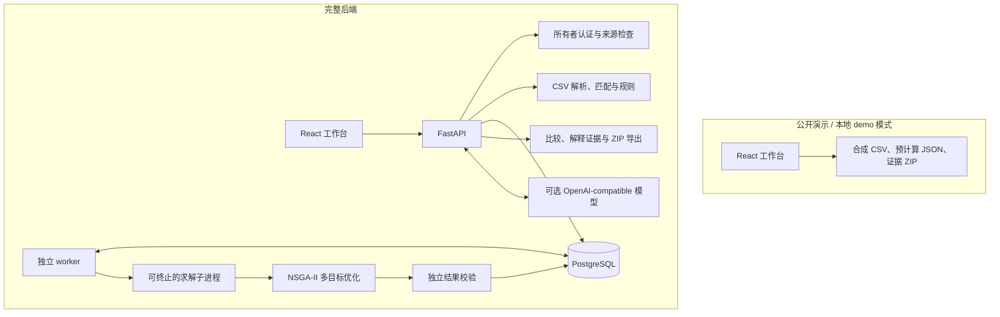
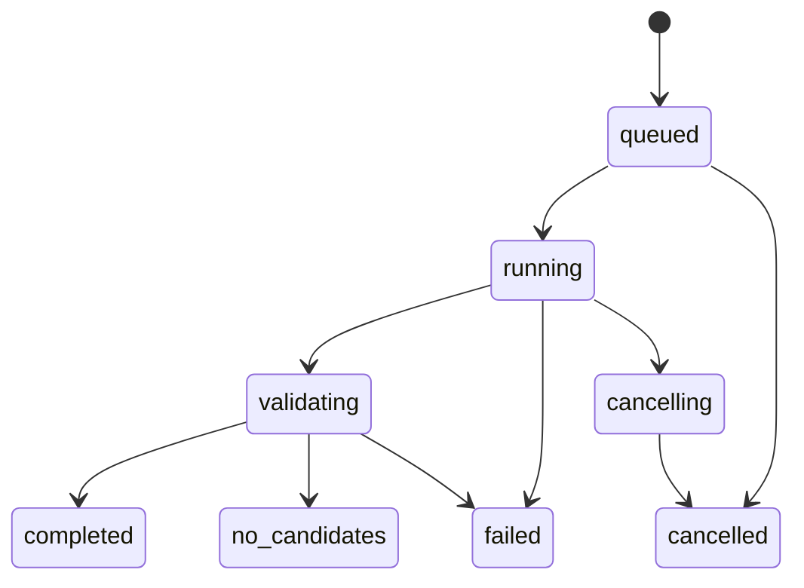

# 系统架构

GateFlow 有两条运行路径，共用同一套 React 工作台。公开演示面向快速体验，完整后端负责私人数据、求解与持久化。

## 两种运行路径

`npm run demo` 使用 `web/.env.demo` 禁用私人 API。GitHub Pages 构建同样使用 `VITE_DEMO_ONLY=true`。前端只读取公开合成材料；不会在浏览器持有模型密钥或运行 Python 求解器。

完整部署中 API 同时提供构建后的前端。PostgreSQL 保存数据、原始 CSV、运行、方案选择与调用记录。API 和 worker 使用相同代码与规则版本，当前部署为一个 API、一个 worker、一个所有者。

## 一次任务如何完成

1. 上传登机口、飞机周转和中转旅客 CSV；服务端检查字段、时间、机型与关联关系。
2. 对无法匹配的客流明确提示，由用户修正或确认排除范围。
3. 用户选择目标、预算和种子，或让 AI 提出受支持的配置建议。
4. 服务端生成配置预览及确认凭证；用户确认后，以幂等键创建持久任务。
5. worker 领取任务，在子进程执行 NSGA-II；进度写入数据库，页面轮询状态。取消请求可终止计算。
6. 独立检查器复核每套候选的占用、兼容、缓冲和指标。结果可在刷新后恢复查看。
7. 用户比较方案、检查周转与旅客组，选用并导出证据。导出不是向真实机场系统下发指令。

上图展示主要业务路径；异常中断的恢复由 worker 与数据库状态检查处理，不能据此推导分布式任务系统的高可用保证。

## AI、优化器和人的分工

| 角色 | 可以做什么 | 不承担什么 |
| --- | --- | --- |
| AI 辅助 | 结构化配置建议、选择已有证据与解释重点 | 自由修改指标、分配、权限或直接下发计划 |
| NSGA-II | 在已定义的目标与约束中生成候选 | 证明全局最优、解释所有真实机场规则 |
| 独立校验 | 按当前规则包复核可行性和指标 | 替代机场生产安全与业务审批 |
| 用户 | 确认范围和配置、比较并选择方案 | 无需接受一个未经复核的模型结论 |

服务端模型输出经过 schema 校验；指标和差额由程序计算。密钥仅保留在服务端，配置模型后还需所有者同意发送范围。无模型时仍可完成表单工作流；公开 Demo 的解读为确定性摘要。

## 前端设计与状态

- `App.tsx`：数据、运行、当前方案、比较集合及页面状态；处理导入、配置、解释与导出。
- `charts.tsx`：航站资源示意、可筛选时间轴和候选取舍图。
- `api.ts`：API 客户端、演示模式标识和数值格式化。
- `style.css`：基础表单、表格、弹窗等组件；`cockpit.css`：航空工作台主题与响应式布局。
- `terminal-apron.jpg`：静态建筑底图。上层登机口按钮读取实际方案状态；背景不是机场实景或实时地图。

方案切换同时更新指标、示意和时间轴，并清除旧解释。登机口筛选可清除，航站示意可折叠。窄屏将解读面板放到主区下方，时间轴保持局部横向滚动。

## 数据与部署边界

当前研究规则包采用 T/S 两厅、N/W 机体类别、D/I 到离港兼容和 45 分钟缓冲。`UNASSIGNED` 表示尚未安排固定口。流程成本含模型惩罚，不能直接换算为实际误机或真实节省时间。

生产接入需要进一步建设机场规则、实时接口、权限和运行保障。数据库当前以 `create_all` 初始化全新实例，升级表结构前须设计迁移。现有 Compose 配置不代表已完成所有目标云环境验收。

[部署指南](DEPLOYMENT.md) · [验证记录](VALIDATION.md) · [返回首页](../README.md)
